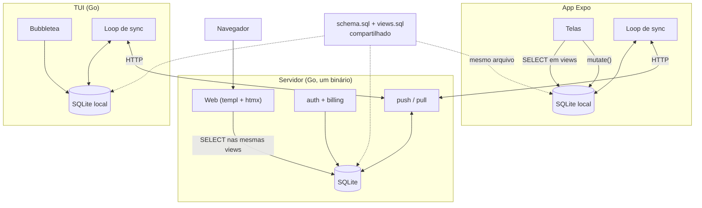
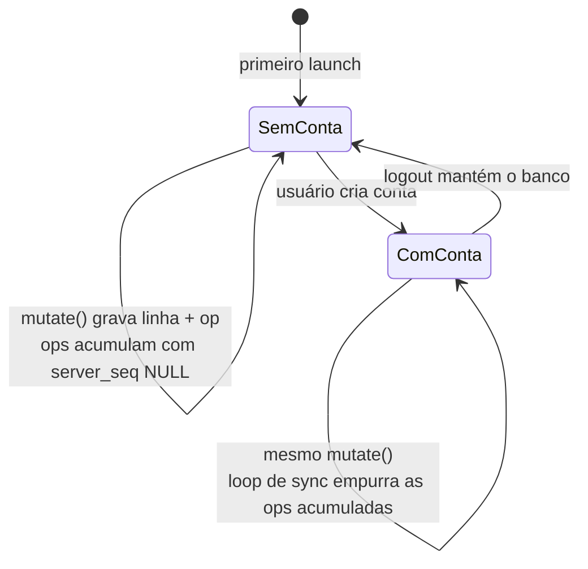
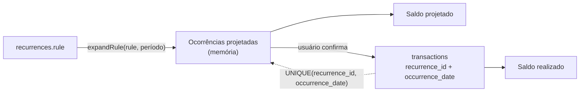

# 01. Arquitetura

## Princípios

Quatro regras. Todo o resto do desenho é consequência delas.

1. **O SQLite local é a fonte de verdade.** Não é cache do servidor.
2. **Nenhuma leitura vai à rede.** A rede aparece em dois lugares no código inteiro: o push e o pull do oplog.
3. **Toda escrita de domínio passa por uma função só**, que grava a linha e a op na mesma transação SQL.
4. **Um arquivo de banco é uma conta.**

A regra 2 elimina a distinção entre "app offline" e "app logado". São o mesmo código. A diferença é se o loop de sync tem destino configurado.

## Topologia

O servidor não é um serviço de sync especial. Ele é outro cliente com o mesmo schema, que por acaso está sempre online e é a autoridade da ordenação. É isso que faz o web ler as mesmas views que o app lê localmente.

O web é o único front que não é local-first. Ele fala direto com o servidor, e isso é uma escolha, não uma inconsistência. Um web server-first é bem mais simples que um SPA local-first, e ele não precisa funcionar sem rede.

## Os três modos que não existem

Não existe migração de dados na transição. O que muda é uma chave em `app_state` e o loop de sync passar a ter destino. As ops criadas no modo sem conta sobem no primeiro push como qualquer outra op.

## Camadas do banco local

Três responsabilidades separadas. A confusão entre elas era o problema do desenho anterior.

| Camada | Tabelas | Sincroniza? |
|---|---|---|
| Estado local | `app_state` | Não. É por device |
| Domínio | `categories`, `tags`, `transactions`, `recurrences` | Sim |
| Mecânica de sync | `sync_operations`, `sync_checksums` | Não. É o mecanismo |

Identidade (`users`, `sessions`, `accounts`, `account_users`, `devices`) **não existe no banco local**. Ela é do servidor. O cliente guarda o token no keychain do sistema (`expo-secure-store` no app) e o `account_id`, `device_id` e `owner_id` em `app_state`.

## Modelo de compartilhamento

Compartilhar conta é união somente-leitura, e essa decisão de produto elimina a parte mais difícil do sistema.

- Toda linha de domínio tem `owner_id`
- **Só o dono muta a linha.** O servidor rejeita op cujo `owner_id` não seja o da linha
- Categoria e tag são da conta, criadas e editadas só pelo `OWNER` da conta
- Membro vê as linhas dos outros como somente-leitura

Consequência: dois usuários diferentes nunca conflitam. O único cenário de escrita concorrente é o mesmo usuário em dois aparelhos, e para isso a ordem total do servidor basta.

## Recorrência é projeção, não linha

Nenhum cron, em lado nenhum. O cliente calcula a ocorrência a partir da `rule` no momento da leitura. Uma linha só nasce quando o usuário confirma que a ocorrência aconteceu.

Materializar cria um problema sem saída. Uma linha materializada automaticamente afirma que um fato aconteceu sem ninguém ter observado, e o usuário pode tê-la editado à mão antes de a regra mudar. Ao editar a regra retroativamente você teria que escolher entre apagar a edição do usuário ou deixar linha órfã. A projeção não tem esse problema, e o `UNIQUE(recurrence_id, occurrence_date)` dá idempotência na confirmação. Confirmar de dois aparelhos produz a mesma linha.

## Decisões descartadas e o motivo

| Opção | Por que não |
|---|---|
| Turso Sync / embedded replicas | Servidor de sync novo é closed-source, então não atende o self-host. Cliente em BETA para dado financeiro |
| PowerSync, ElectricSQL | Sem cliente Go. Electric ainda é só caminho de leitura, com Postgres como fonte de verdade |
| Evolu, Jazz, TinyBase, LiveStore, Triplit, RxDB | Sem cliente Go. Evolu é E2E por design, incompatível com servidor que lê em claro |
| cr-sqlite | Evitaria escrever o merge, mas aposta a fundação numa extensão de um mantenedor, com cerimônia em cada `ALTER TABLE` e caminho web não verificado |
| TanStack DB | Quer ser o store local. O schema, as migrations e as views são nossos e compartilhados com Go |
| Zustand ou Jotai como camada de dados | São gerenciadores de estado, não caches de query. Sem chave, sem invalidação, sem paginação |
| Drizzle com `useLiveQuery` | Quer ser a fonte do schema. Nosso schema é um `.sql` canônico compartilhado com Go |
| WASM dentro de React Native | Hermes não tem WebAssembly. Polyfills arquivados ou parados |
