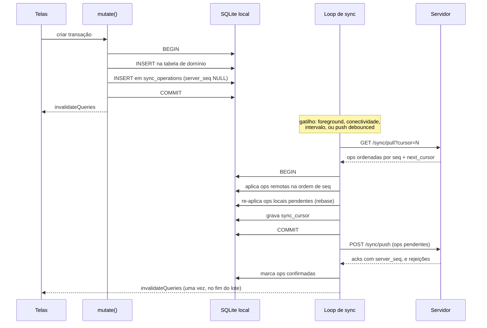
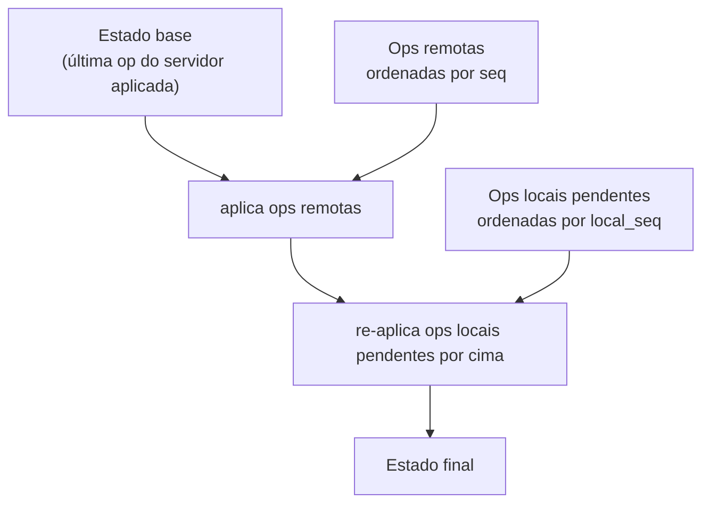
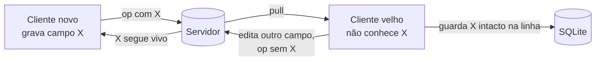
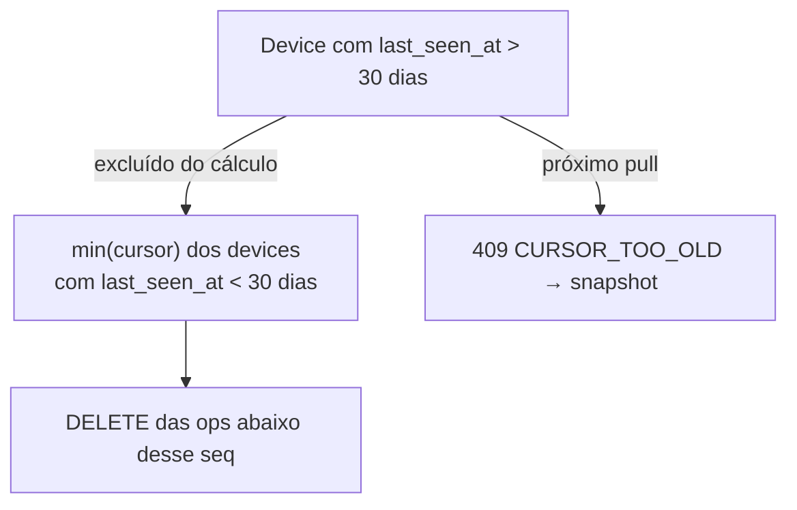

# 03. Sync

Protocolo próprio. O desenho segue o oplog do Actual Budget e o contrato push/pull do Replicache.

## Ordem total, e por que ela substitui o merge

O servidor atribui `seq` a cada op no momento do commit. Isso dá uma **ordem total** das ops dentro da conta.

**LWW por linha não é uma regra de comparação. É consequência da ordem.** Não existe "comparar timestamps e decidir quem vence". Você aplica as ops remotas na ordem de `seq`, e a última vence. O `server_seq` na linha existe para depuração e checksum, e não decide nada.

O que a ordem total **não** resolve é a op local que ainda não subiu, porque ela não tem `seq`. Para isso existe o rebase.

## O ciclo de sync



## Rebase, não merge

Este é o ponto que se erra sem perceber.

Quando o pull traz uma op remota para uma linha que o usuário editou localmente e ainda não subiu, aplicar a op remota direto apaga a edição que o usuário fez segundos antes.

O modelo correto:



Isso converge porque a ordem do servidor é autoritativa e as ops locais pendentes vão receber o próprio `seq` no push seguinte. Como `owner_id` garante que só o dono muta a linha, essa colisão só acontece entre dois aparelhos da mesma pessoa, o que é raro. Mas quando acontece, sem rebase o dado se perde.

Todo o bloco (aplicar remotas, rebasear, gravar cursor) roda numa transação SQL só.

## Formato da op

```json
{
  "id": "01JXQ8Z9K3M4N5P6Q7R8S9T0AB",
  "entity": "TRANSACTION",
  "entity_id": "01JXQ8Z8000000000000000000",
  "kind": "UPDATE",
  "payload": { "amount": 4590, "category_id": "01JXQ8Z7000000000000000000" },
  "protocol_version": 1,
  "device_id": "01JXQ8Z6000000000000000000",
  "owner_id": "01JXQ8Z5000000000000000000",
  "created_at": "2026-08-23T14:02:11Z"
}
```

Regras:

- `id` é ULID gerado no cliente e é a **chave de idempotência**. O servidor deduplica por `(device_id, id)`
- `payload` é parcial: só os campos que mudaram. Em `CREATE` é a linha inteira; em `DELETE` é vazio
- `kind = DELETE` grava `deleted_at`, nunca remove linha
- o cliente **nunca** inventa `server_seq`. Só o servidor atribui

## Contrato HTTP

### `POST /sync/push`

```json
{ "device_id": "...", "protocol_version": 1, "ops": [ /* ops em ordem de local_seq */ ] }
```

Resposta:

```json
{
  "acks": [ { "id": "01JXQ8...", "server_seq": 4812 } ],
  "rejected": [ { "id": "01JXQ9...", "reason": "NOT_OWNER" } ]
}
```

Motivos de rejeição:

| Motivo | Significado | O que o cliente faz |
|---|---|---|
| `NOT_OWNER` | `owner_id` da op não é o dono da linha | Descarta a op e reverte a linha no próximo pull. É bug de cliente |
| `UNSUPPORTED_PROTOCOL` | Servidor não entende essa versão | Para de sincronizar e pede atualização do app |
| `FORBIDDEN_ENTITY` | `MEMBER` tentou escrever categoria ou tag | Descarta. É bug de UI, que devia ser somente-leitura |

Push é idempotente. Reenviar a mesma op devolve o mesmo `server_seq`.

### `GET /sync/pull?cursor=N&limit=500`

```json
{ "ops": [ /* ordenadas por seq crescente */ ], "next_cursor": 5312, "up_to_date": false }
```

O cliente repete o pull enquanto `up_to_date` for falso.

| Situação | Resposta |
|---|---|
| Cursor válido | Ops a partir de `cursor`, exclusivo |
| Cursor abaixo do mínimo retido | HTTP 409 com `{ "reason": "CURSOR_TOO_OLD" }` |

`CURSOR_TOO_OLD` significa resync completo: o cliente descarta o estado de domínio, mantém as ops pendentes, puxa snapshot, e reaplica as pendentes por cima.

## Migração de protocolo

Vai existir permanentemente celular desatualizado falando com servidor novo. As três regras, e a segunda é a que se esquece:

1. **Mudança só aditiva.** Nunca renomear, nunca remover campo. Campo que morre é ignorado, não removido
2. **Cliente que recebe campo desconhecido preserva o campo.** Se descartar, a próxima escrita dele apaga o dado que o cliente novo gravou. É por isso que `payload` é JSON e o apply faz overlay do que conhece, em vez de desserializar em struct fechado
3. **Servidor recusa op com `protocol_version` que não entende**, em vez de adivinhar



## Poda do oplog

Você só pode podar abaixo do menor cursor entre todos os devices conhecidos. Um device que sumiu travaria a poda para sempre.

**Política: 30 dias.** Device sem sincronizar por mais de 30 dias tem o cursor invalidado. No próximo pull ele recebe `CURSOR_TOO_OLD` e faz resync por snapshot, o que libera a poda.



## Detecção de divergência

Sem isso, divergência é silenciosa. Ela aparece como "meu saldo está errado" meses depois, sem log e sem como reconstruir.

O cliente calcula um checksum por período (mês) sobre as linhas não deletadas, grava em `sync_checksums`, e manda junto com o pull. O servidor compara com o próprio. Divergência num período dispara resync daquele período.

Começa com checksum por período. Merkle trie, como o Actual usa, só se o checksum simples ficar caro.

## Os oito furos do desenho anterior

| Furo | Correção |
|---|---|
| Cursor sobre ULID do cliente perdia ops em silêncio: device offline gera ULID "antigo" e o outro device nunca vê | `server_seq` atribuído pelo servidor. ULID só como chave de idempotência |
| `version INTEGER` detectava conflito mas não resolvia: dois devices iam de 1 para 2 sem desempate | Ordem total do servidor, mais `owner_id` que elimina conflito entre pessoas |
| `created_at` do cliente ordenava ops, vulnerável a clock skew | Ordem é do servidor. `local_seq` só ordena ops pendentes locais |
| FK estourava com op fora de ordem causal | Sem `REFERENCES` nas tabelas sincronizáveis |
| `payload BLOB` sem versão de schema travava a primeira migração | `protocol_version` na op, payload JSON, campo desconhecido preservado |
| Identidade no banco local, com hash de senha, e não sincronizava | Identidade é do servidor. Segundo device faz login e pull desde zero |
| Nenhuma detecção de divergência | `sync_checksums` por período |
| Nenhuma política de poda | 30 dias, cursor invalidado, resync por snapshot |
