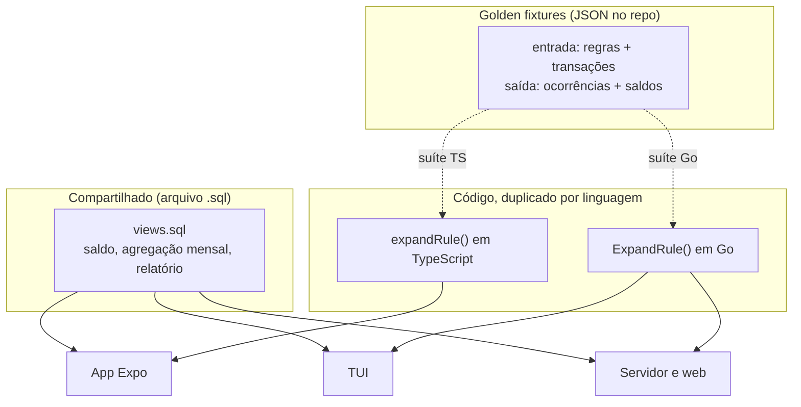
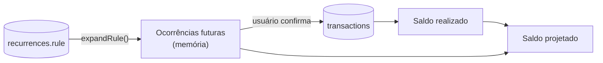

# 04. Dados derivados

O cliente não grava nada derivado. Ele calcula saldo, agregação e ocorrência de recorrência na leitura.

## Onde cada coisa mora



A regra: **se cabe em SQL, vai para a view.** Só a expansão da `rule` fica em código, porque ela gera linhas que não existem.

## Views

Agregação em SQL significa uma implementação para os três clientes. Elas vivem no mesmo `.sql` do schema.

| View | Responsabilidade |
|---|---|
| `v_transactions_active` | Base de todas as outras. Filtra `deleted_at IS NULL` e resolve categoria ausente |
| `v_balance_realized` | Soma de `INCOME` menos `OUTCOME` sobre as transações confirmadas |
| `v_monthly_summary` | Por mês, por `kind`, por categoria: total e contagem |
| `v_category_usage` | Gasto do mês por categoria contra `monthly_limit` |

Esboço da base. Ela carrega duas decisões:

```sql
CREATE VIEW v_transactions_active AS
SELECT
  t.id,
  t.owner_id,
  t.kind,
  t.amount,
  t.description,
  t.occurred_at,
  t.recurrence_id,
  t.occurrence_date,
  -- category may be absent: the op that creates it can arrive later
  COALESCE(c.id, '') AS category_id,
  COALESCE(c.name, 'Sem categoria') AS category_name,
  COALESCE(c.color, 'GRAY') AS category_color
FROM transactions t
LEFT JOIN categories c
  ON c.id = t.category_id
 AND c.deleted_at IS NULL
WHERE t.deleted_at IS NULL;
```

`LEFT JOIN` e não `JOIN`, e `COALESCE` no lugar da FK que não existe. Assim a transação continua visível quando a op da categoria ainda não chegou.

## Saldo realizado e saldo projetado

São dois números diferentes e a UI precisa distinguir, senão o app afirma um fato que ninguém observou.

| Número | Origem | Significado |
|---|---|---|
| Realizado | `v_balance_realized` | Só o que virou linha. É a verdade |
| Projetado | Realizado mais ocorrências expandidas até uma data | Estimativa. Nunca vira dado |



## A `rule` de recorrência

`rule` é texto. A expansão recebe a regra e um intervalo, e devolve as datas de ocorrência dentro dele.

```
expandRule(rule, start_at, end_at, from, to) -> [data]
```

Requisitos da função, nas duas linguagens:

- **Pura e determinística.** Mesma entrada, mesma saída, sem relógio interno e sem fuso local
- **Não emite ocorrência já confirmada.** Quem filtra é a query, comparando com `(recurrence_id, occurrence_date)` das transações existentes
- **Respeita `start_at` e `end_at`** da recorrência, além do intervalo pedido
- **Trata mês curto.** Regra mensal no dia 31 em fevereiro precisa de política explícita, e ela vira caso de fixture

## Golden fixtures

É o mecanismo que impede Go e TypeScript de divergirem. Sem ele, a divergência entre as duas implementações aparece como saldo diferente no app e no TUI, sem erro em lado nenhum.

Formato: um diretório de arquivos JSON versionados no repo, cada um com entrada e saída esperada.

```json
{
  "name": "monthly on day 31 across february",
  "rule": "MONTHLY:31",
  "start_at": "2026-01-31",
  "end_at": null,
  "window": { "from": "2026-01-01", "to": "2026-04-30" },
  "expected": ["2026-01-31", "2026-02-28", "2026-03-31", "2026-04-30"]
}
```

As duas suítes leem o mesmo diretório. Divergência entre as implementações vira teste vermelho, não bug de produção.

Casos que precisam existir desde o começo: mês curto, ano bissexto, regra com `end_at` no meio da janela, janela que não contém nenhuma ocorrência, ocorrência exatamente em `start_at`, e recorrência deletada (tombstone) que não deve projetar nada.
