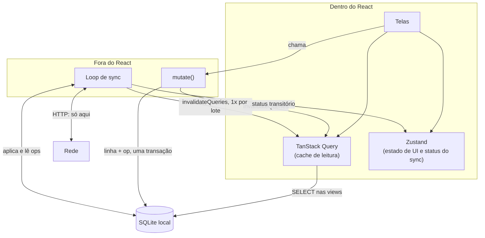

# 05. Camada de dados no app

Banco: `expo-sqlite`. Cache de leitura: TanStack Query. Estado de UI: Zustand. Sync: módulo fora do React.

## As três camadas e quem fala com quem



A rede aparece num lugar só do app inteiro. A TanStack Query não sabe que o sync existe; o sync não sabe que o React existe.

## TanStack Query como cache puro

A biblioteca foi feita para dado remoto, onde `staleTime` e refetch existem para decidir quando buscar de novo. Dado local não fica velho: ele é a verdade. Então metade da configuração default precisa ser desligada.

```ts
const queryClient = new QueryClient({
  defaultOptions: {
    queries: {
      staleTime: Number.POSITIVE_INFINITY, // SQLite is authoritative, never stale
      gcTime: Number.POSITIVE_INFINITY,
      retry: 0,                            // a disk read does not fail from network
      refetchOnWindowFocus: false,
      refetchOnReconnect: false,
    },
  },
})
```

Ela fica porque continua entregando quatro coisas: chave estruturada por entidade, invalidação em lote, deduplicação de query concorrente, e `useInfiniteQuery` pronto para a lista de recorrências.

O que sai do projeto:

| Removido | Motivo |
|---|---|
| `@tanstack/query-async-storage-persister` | O SQLite é a persistência. Cachear o cache produz dado velho |
| `@tanstack/react-query-persist-client` | Mesmo motivo |
| Fiação do `onlineManager` com NetInfo | Nenhuma leitura depende de rede. NetInfo continua no projeto, mas como gatilho do loop de sync |
| `ky` e o caminho de dados de `src/shared/api/` | Não existe leitura pela rede |
| `networkMode: "offlineFirst"` nas mutations | Mutation agora é escrita em SQLite, síncrona |

O `queryFn` muda de corpo, e o resto do hook não muda:

```ts
export function useTransactions(filters?: TransactionFilters) {
  return useQuery({
    queryKey: queryKeys.list(filters),
    queryFn: () => selectTransactions(filters), // SELECT em v_transactions_active
  })
}
```

Sai também o `enabled: !!isSignedIn`. Leitura nunca depende de login.

## `mutate()`, a única função que escreve

Existe exatamente um lugar que escreve em `categories`, `tags`, `transactions` e `recurrences`.

```ts
// src/shared/sync/mutate.ts
export async function mutate(input: MutationInput) {
  assertOwnership(input) // rows owned by other members are read-only

  await db.withTransactionAsync(async () => {
    await applyToEntityTable(input)
    await insertSyncOperation({
      ...input,
      id: ulid(),
      deviceId: appState.deviceId,
      ownerId: appState.ownerId,
      protocolVersion: PROTOCOL_VERSION,
      serverSeq: null,
    })
  })

  queryClient.invalidateQueries({ queryKey: [input.entity] })
  sync.schedulePush()
}
```

Por que não pode ter exceção. Se **um** caminho de código escrever sem produzir op, aquela escrita nunca sincroniza, e a falha é invisível. A linha existe no aparelho para sempre e não aparece no outro. Sem erro e sem log.

Um teste garante a invariante. Ele varre `src/` procurando `INSERT INTO` ou `UPDATE` nas tabelas de domínio fora de `src/shared/sync/`, e falha o build se achar. É grep, não teste de unidade.

## O loop de sync vive fora do React

Não é query nem mutation.

- **Não é query**: o ciclo de vida ficaria amarrado à montagem de um componente, e o sync precisa rodar independente de qual tela está aberta
- **Não é mutation**: mutation é ação do usuário, one-shot, e o resultado volta para a UI. O sync é um loop com backoff cujo resultado é "mil linhas mudaram"
- **Conflito de política**: `staleTime` e refetch decidem quando buscar. O loop decide isso sozinho, por gatilho

```ts
// src/shared/sync/loop.ts
async function runOnce() {
  const pulled = await transport.pull(await getCursor())

  await db.withTransactionAsync(async () => {
    for (const op of pulled.ops) await applyRemoteOp(op)
    await rebasePendingLocalOps()
    await setCursor(pulled.nextCursor)
  })

  const acks = await transport.push(await getPendingOps())
  await markAcked(acks)

  queryClient.invalidateQueries() // once per batch, not per op
}
```

Gatilhos, todos dentro do módulo:

| Gatilho | Origem |
|---|---|
| App volta para foreground | `AppState` |
| Conectividade voltou | `NetInfo` |
| Intervalo | timer |
| Escrita do usuário | `schedulePush()` debounced pelo `mutate()` |
| Pull-to-refresh | `sync.runNow()` chamado pela tela |

Duas invariantes: **single-flight**, nunca dois `runOnce` concorrentes, senão o rebase acontece sobre um estado que outro pull está mudando; e nunca rodar dentro da transação do `mutate()`.

## Status do sync na UI

O sync não aparece na UI, mas o estado dele aparece, e a divisão é limpa:

| O que | Onde | Por quê |
|---|---|---|
| Contagem de ops pendentes | TanStack Query | É `SELECT count(*) FROM sync_operations WHERE server_seq IS NULL`, uma query como qualquer outra |
| Rodando, erro, último sync | Zustand | Efêmero, não pertence ao SQLite |
| Spinner do pull-to-refresh | `useMutation` fino sobre `sync.runNow()` | Embrulho de UI, opcional |

## O que "lugar do sync reservado" significa

O módulo existe desde o primeiro commit, com `transport` sendo um stub que não faz nada. Loop, gatilhos, `applyRemoteOp`, rebase e invalidação todos escritos e testados contra dois bancos locais. Quando o servidor existir, implementa-se `transport.pull` e `transport.push` e nada mais é tocado.

Checklist da reserva:

- [ ] toda escrita passa por `mutate()`, sem exceção, garantido por teste
- [ ] `sync_operations` acumula com `server_seq NULL`
- [ ] `sync_checksums` existe, vazia
- [ ] `device_id` gerado no primeiro launch, em `app_state`
- [ ] `protocol_version` em cada op
- [ ] delete é sempre tombstone
- [ ] ULID em tudo
- [ ] nenhuma leitura vai à rede
- [ ] `applyRemoteOp` e rebase implementados e testados sem servidor

## Pendência conhecida

O loop só roda com o app em foreground, a menos que se adicione `expo-background-task`. Em iOS isso significa que o app fechado não sincroniza. Para finanças pessoais isso é aceitável, e background task no iOS é pouco confiável. Decisão para depois do servidor.
