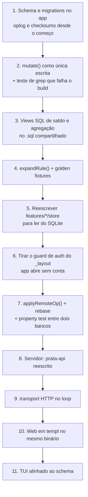

# 06. Implementação

Ordem: o app funciona completamente offline primeiro, com o lugar do sync reservado. Servidor e sync depois.

Não existe dado real em produção, então o schema novo é um `DROP`. Nenhuma migração in-place.

## Ordem

O passo 7 é o contraintuitivo e não deve ser adiado. Escrever a aplicação de ops junto com a produção delas é o que transforma as decisões deste documento em teste. Sem ele, o furo do cursor e o do rebase só aparecem com dado de usuário real.

## Passo 7 em detalhe: provar convergência sem servidor

Um teste que abre dois SQLites, aplica ops divergentes em cada um, troca as ops entre eles nos dois sentidos, e afirma que os dois bancos ficam iguais.

Casos obrigatórios:

| Caso | O que ele pega |
|---|---|
| Mesmo campo editado dos dois lados | Ordem total e rebase |
| Delete concorrente com update | Tombstone versus ressurreição de linha |
| Op chegando duas vezes | Idempotência por `(device_id, id)` |
| Ops chegando fora de ordem causal | Ausência de FK, categoria ausente |
| Op local pendente durante um pull | Rebase, o furo que mais custa |
| Op com campo desconhecido | Preservação, regra de migração |

Como property test, com ordem de ops gerada aleatoriamente, ele cobre o espaço que os casos escritos à mão não cobrem.

## O que sai

### `prata-app`

| Item | Motivo |
|---|---|
| `src/shared/db/provider.tsx` | Código morto. Nunca foi montado, e o Turso está fora |
| Caminho de dados de `src/shared/api/` | Nenhuma leitura pela rede |
| `ky` | Sem cliente HTTP no caminho de dados. Volta só no `transport` do sync |
| `@tanstack/query-async-storage-persister` | O SQLite é a persistência |
| `@tanstack/react-query-persist-client` | Idem |
| `enabled: !!isSignedIn` em todo hook | Leitura não depende de login |
| `Stack.Protected` em `src/app/_layout.tsx` | O app abre sem conta |
| Bloqueio de render em `(private)/_layout.tsx` no `useBalance()` | Saldo vem de view local, é síncrono |
| `TURSO_SYNC_URL` e `TURSO_AUTH_TOKEN` do `.env` | Turso fora. Rotacionar o token antes de descartar |

### `prata-api`

| Item | Motivo |
|---|---|
| Handlers de domínio (`me/transactions`, `me/recurrences`, `me/balance`) | Substituídos por push e pull |
| `cmd/cron` inteiro | Recorrência é projeção. Nenhum cron |
| `tursodatabase/go-libsql` | Driver legado do Turso. Trocar por driver SQLite comum |

O que fica: auth com JWT, chi, sqlx e o mecanismo de migrations.

### `prata-tui`

| Item | Motivo |
|---|---|
| `turso.tech/database/tursogo` | Turso fora. Trocar por driver SQLite comum |
| `users`, `sessions` e `users.secret` do banco local | Identidade é do servidor. Token no keyring do OS |
| `account_id` nas linhas de domínio | Um banco é uma conta |
| Cursor `last_pulled_id` / `last_pushed_id` | Substituído por `server_seq` do servidor |
| `version INTEGER` como desempate | Substituído pela ordem total |
| `REFERENCES` nas tabelas sincronizáveis | Op chega fora de ordem |

### `prata`

Repo inteiro. É um app Expo antigo com tamagui, abandonado.

## Riscos registrados

| Risco | Mitigação |
|---|---|
| Protocolo projetado sem nunca ter rodado | Passo 7 antes do servidor |
| Go e TypeScript divergirem na expansão da `rule` | Golden fixtures rodadas pelas duas suítes |
| Escrita fora do `mutate()` passando sem ser notada | Teste de grep no build |
| Divergência silenciosa entre aparelhos | `sync_checksums` por período |
| Cliente desatualizado apagando campo de cliente novo | Payload JSON com preservação de campo desconhecido |
| Sync não rodar em background no iOS | Decisão explícita depois do servidor |
| Três frontends antes de um funcionar | App inteiro antes do servidor |
